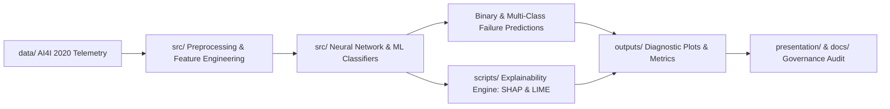

# Predictive Maintenance with Explainable AI (XAI)


## Overview
Modern deep learning and ensemble classifiers achieve high accuracy in predicting industrial equipment failures, yet their "black-box" nature often prevents maintenance engineers from trusting automated alerts in safety-critical environments. 

Developed as a graduate course project on **Responsible and Explainable AI** at the **University of Regina**, this repository implements an end-to-end **Predictive Maintenance & Root-Cause Diagnostic Pipeline** on the **AI4I 2020 Predictive Maintenance Dataset**. By pairing neural network and machine learning classifiers with post-hoc explainability frameworks (**SHAP** and **LIME**), the system translates raw telemetry predictions into transparent, human-auditable maintenance insights.

---

## System Architecture



---

## Key Features & Industrial Failure Modes
* **Telemetry & Physical Feature Modeling:** Evaluates air temperature, process temperature, rotational speed (RPM), torque (Nm), and tool wear (minutes) across varying product quality tiers (`L`, `M`, `H`).
* **Multi-Mode Failure Diagnostics:** Detects overall machine failure alongside five distinct root-cause failure modes:
  * **TWF:** Tool Wear Failure
  * **HDF:** Heat Dissipation Failure
  * **PWF:** Power Failure
  * **OSF:** Overstrain Failure
  * **RNF:** Random Failures
* **Global & Local Interpretability (XAI):**
  * **Global Attribution (SHAP Summary & Dependence Plots):** Identifies which physical sensors drive risk across the entire factory floor.
  * **Instance-Level Diagnostics (LIME & SHAP Force/Waterfall Plots):** Explains *why* an individual machine was flagged for imminent failure so technicians know exactly which component to inspect.

---

## Repository Structure

```text
xai-predictive-maintenance/
├── data/                   # AI4I 2020 Predictive Maintenance dataset & processed splits
├── docs/                   # Project report, literature review, and Responsible AI documentation
├── notes/                  # Research notes and explainability methodology breakdowns
├── outputs/                # Generated confusion matrices, ROC curves, SHAP, and LIME visualizations
├── presentation/           # Final project defense slide deck and speaker materials
├── scripts/                # Execution scripts for model training and XAI explainability generation
├── src/                    # Core source modules (data preprocessing, neural network, and ML models)
├── .gitignore              # Git exclusion rules for virtual environments and cache files
├── requirements.txt        # Python package dependencies
└── README.md               # Project documentation
```

---

## Quickstart & Reproduction

### 1. Clone the Repository
```bash
git clone [https://github.com/dipenpatel1/xai-predictive-maintenance.git](https://github.com/dipenpatel1/xai-predictive-maintenance.git)
cd xai-predictive-maintenance
```

### 2. Install Dependencies
```bash
python -m venv venv
# Windows:
venv\Scripts\activate
# macOS/Linux:
source venv/bin/activate

pip install -r requirements.txt
```

### 3. Run Training & Explainability Scripts
Execute the training and explainability scripts in `scripts/` and `src/` to train the predictive models and regenerate the diagnostic plots inside `outputs/`:
```bash
python scripts/train.py
```

---

## Contributors & Academic Context
* **Dipen Patel** ([@dipenpatel1](https://github.com/dipenpatel1)) — *Master of Engineering in Software Systems Engineering, University of Regina*
* **Bijay Pandey** ([@Bijay2052](https://github.com/Bijay2052)) — *University of Regina*
* **Course:** Responsible and Explainable AI (`ENSE 861` / `ENSE 885BG`), Faculty of Engineering & Applied Science, University of Regina.
